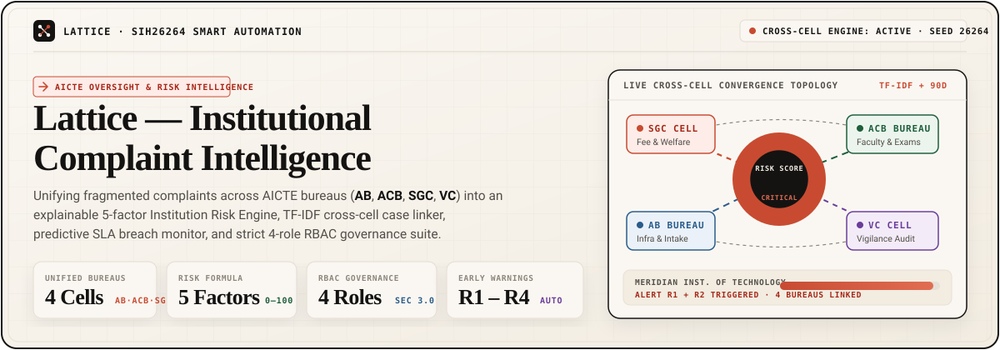
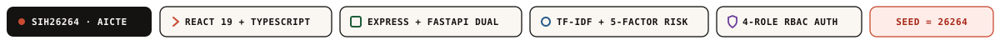
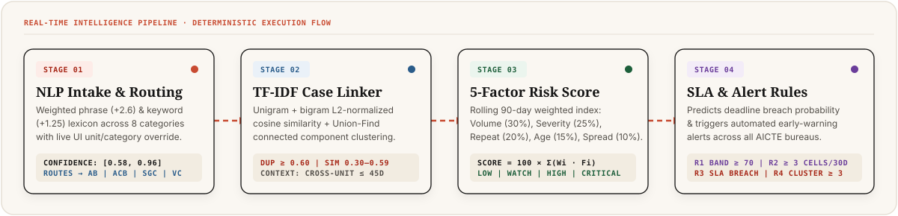
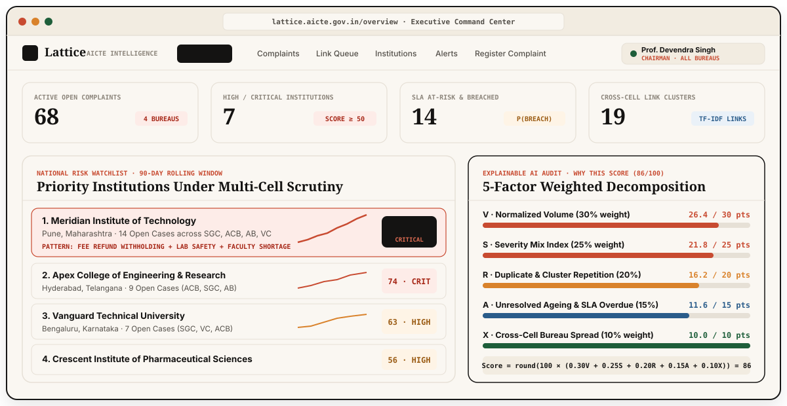
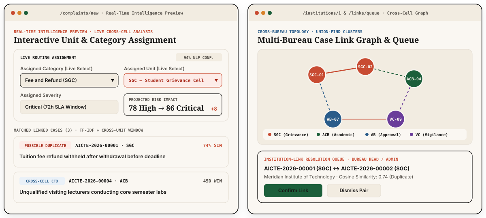
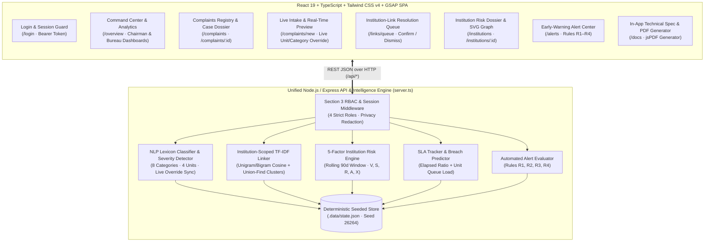
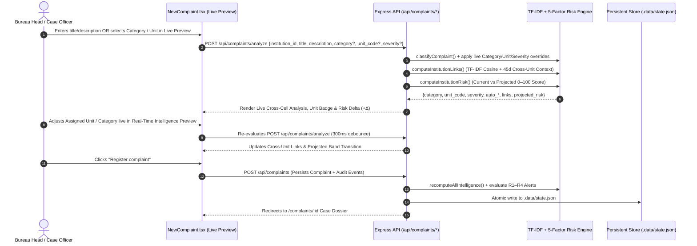
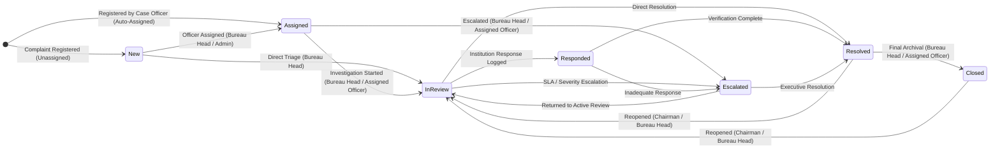
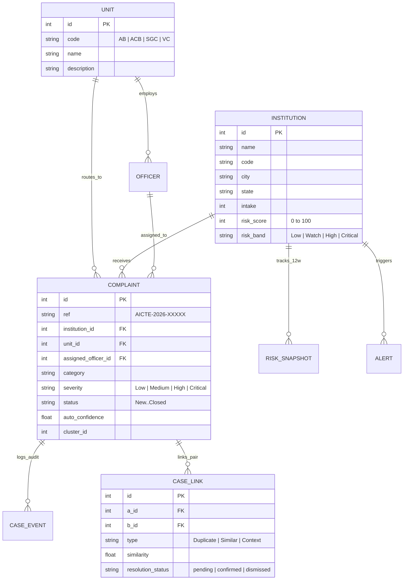

<div align="center">



<br />



<br />

<p align="center">
  <strong>Integrated Cross-Bureau Complaint Tracking, TF-IDF Case Linking, Explainable 5-Factor Institution Risk Scoring, and Role-Based Governance for AICTE</strong>
</p>

<p align="center">
  <a href="#-system-overview--core-capabilities">Overview</a> ·
  <a href="#-interface--project-visual-showcase">Project Visuals</a> ·
  <a href="#-system-architecture--mermaid-blueprints">Architecture</a> ·
  <a href="#-role-based-access-control-rbac--credentials">RBAC &amp; Login</a> ·
  <a href="#-intelligence-engine-mathematics">Risk Mathematics</a> ·
  <a href="#-installation--local-setup">Quick Start</a> ·
  <a href="#-rest-api-specification">API Reference</a>
</p>

</div>

---

##  System Overview & Core Capabilities

**Lattice** (**Problem Statement SIH26264 — Smart Automation**) eliminates organizational silos across the All India Council for Technical Education (**AICTE**) by connecting institution-related complaints across all four regulatory bureaus and cells into a single, real-time intelligence fabric:

<table>
  <thead>
    <tr>
      <th width="25%" align="left">
         <strong>AB — Approval Bureau</strong>
      </th>
      <th width="25%" align="left">
         <strong>ACB — Academic Bureau</strong>
      </th>
      <th width="25%" align="left">
         <strong>SGC — Grievance Cell</strong>
      </th>
      <th width="25%" align="left">
         <strong>VC — Vigilance Cell</strong>
      </th>
    </tr>
  </thead>
  <tbody>
    <tr>
      <td>Handles <em>Admissions &amp; Affiliation</em> and <em>Infrastructure &amp; Safety</em> compliance across technical institutions.</td>
      <td>Monitors <em>Faculty &amp; Staffing</em> ratios, lab readiness, and <em>Academic Quality &amp; Exams</em> standards.</td>
      <td>Resolves <em>Fee &amp; Refund</em> withholding, <em>Student Harassment &amp; Welfare</em>, and <em>Document Retention</em> cases.</td>
      <td>Investigates <em>Placement &amp; Misrepresentation</em>, fraudulent claims, and systemic governance violations.</td>
    </tr>
  </tbody>
</table>

> [!IMPORTANT]
> **From Reactive Silos to Predictive Oversight:** Traditional portals treat a fee-refund complaint in **SGC**, a lab-safety complaint in **AB**, and a faculty-shortage complaint in **ACB** as unrelated tickets. **Lattice** unifies these signals at the institution level, linking related cases via **TF-IDF cosine similarity** and computing an explainable **0–100 Institution Risk Score** with automated early-warning alerts (**R1–R4**).

<br />

<div align="center">
  
</div>

---

##  Interface & Project Visual Showcase

### 1. Executive Command Center & Explainable 5-Factor Risk Dossier

The **Command Center (`/overview`)** and **Institution Risk Dossier (`/institutions/:id`)** provide real-time visibility into national complaint volume, SLA health, priority watchlist institutions (led by *Meridian Institute of Technology*), and a transparent **"Why this score"** 5-factor decomposition.

<div align="center">
  
</div>

<br />

### 2. Live Cross-Cell Intake Analysis & Multi-Bureau Link Graph

When registering a complaint (`/complaints/new`), the **Real-Time Intelligence Preview (Live cross-cell analysis)** panel automatically classifies the category, routes the unit, surfaces near-duplicate or cross-unit context links, and projects the institution's risk score jump. Users can also **assign or override the Category, Routed Unit (`SGC`, `ACB`, `AB`, `VC`), and Severity live** inside both the intake form and the Live Cross-Cell Analysis panel, immediately recalculating cross-unit links and risk impact.

<div align="center">
  
</div>

---

##  System Architecture & Mermaid Blueprints

### High-Level Full-Stack Architecture



### Live Intake, Override & Persistence Sequence



---

##  Role-Based Access Control (RBAC) & Credentials

Lattice enforces **Section 3 Role-Based Access Control** with **4 top-level roles only** (`chairman`, `bureau_head`, `case_officer`, `admin`) and **no unit sub-roles**, backed by email and password authentication.

### Section 3 Capability Matrix

<table>
  <thead>
    <tr>
      <th align="left">Capability</th>
      <th align="center"><code>chairman</code></th>
      <th align="center"><code>bureau_head</code></th>
      <th align="center"><code>case_officer</code></th>
      <th align="center"><code>admin</code></th>
    </tr>
  </thead>
  <tbody>
    <tr>
      <td><strong>Register complaint</strong></td>
      <td align="center"> No</td>
      <td align="center"> <strong>Yes</strong></td>
      <td align="center"> <strong>Yes</strong></td>
      <td align="center"> No</td>
    </tr>
    <tr>
      <td><strong>View case list &amp; detail</strong></td>
      <td align="center"> All bureaus, full</td>
      <td align="center"> Full access</td>
      <td align="center"> Full (assigned first)</td>
      <td align="center"> All bureaus, <strong>metadata only</strong></td>
    </tr>
    <tr>
      <td><strong>Assign / reassign officer</strong></td>
      <td align="center"> No</td>
      <td align="center"> <strong>Yes</strong></td>
      <td align="center"> No</td>
      <td align="center"> <strong>Yes</strong></td>
    </tr>
    <tr>
      <td><strong>Add action note</strong></td>
      <td align="center"> No</td>
      <td align="center"> <strong>Yes</strong></td>
      <td align="center"> <strong>Assigned cases</strong></td>
      <td align="center"> No</td>
    </tr>
    <tr>
      <td><strong>Status transitions</strong></td>
      <td align="center"> <strong>Reopen only</strong></td>
      <td align="center"> <strong>Per Section 5</strong></td>
      <td align="center"> <strong>Per Section 5</strong> (assigned)</td>
      <td align="center"> None</td>
    </tr>
    <tr>
      <td><strong>Resolve institution-link queue</strong></td>
      <td align="center"> No</td>
      <td align="center"> <strong>Yes</strong></td>
      <td align="center"> No</td>
      <td align="center"> <strong>Yes</strong></td>
    </tr>
    <tr>
      <td><strong>Chairman dashboard</strong></td>
      <td align="center"> <strong>Yes</strong></td>
      <td align="center"> No</td>
      <td align="center"> No</td>
      <td align="center"> No</td>
    </tr>
    <tr>
      <td><strong>Bureau dashboard</strong></td>
      <td align="center"> No</td>
      <td align="center"> <strong>Yes</strong></td>
      <td align="center"> No</td>
      <td align="center"> No</td>
    </tr>
  </tbody>
</table>

> [!NOTE]
> **Section 3.1 Admin Metadata-Only Redaction:** When logged in as `admin`, the backend automatically strips `description` (`null`), redacts free-text `Note` messages in the audit timeline, and suppresses narrative pattern summaries on institution dossiers while preserving full operational metadata (IDs, timestamps, SLA timers, risk scores, officer assignments, and link queue controls).

### Default Account Credentials (`/login`)

| Role | Account Name | Email | Password | Primary Scope |
| :--- | :--- | :--- | :--- | :--- |
| **`chairman`** | Prof. Devendra Pratap Singh | `chairman@aicte.gov.in` | `Chairman@123` | Chairman Dashboard, full national case inspection, reopen resolved/closed cases, acknowledge alerts |
| **`bureau_head`** | Dr. Rajeshwar Rao | `head@aicte.gov.in` | `Head@123` | Bureau Dashboard, register complaints, assign officers, full Section 5 status transitions, resolve link queue |
| **`case_officer`** | Sneha Kulkarni | `officer@aicte.gov.in` | `Officer@123` | Assigned-first case queue, register complaints, add action notes & transition assigned cases |
| **`admin`** | Ananya Verma | `admin@aicte.gov.in` | `Admin@123` | Metadata-only case inspection, officer assignment/reassignment, institution-link queue resolution |

### Section 5 Case Status State Machine



---

##  Intelligence Engine Mathematics

### 1. Explainable 5-Factor Institution Risk Score ($0\text{–}100$)

Every institution $i$ is evaluated over a rolling **90-day window** ($C_{90}$) across five normalized factors in $[0, 1]$:

$$\text{RiskScore}_i = \text{round}\Big(100 \times \big(0.30\,V_i + 0.25\,S_i + 0.20\,R_i + 0.15\,A_i + 0.10\,X_i\big)\Big)$$

<table>
  <thead>
    <tr>
      <th align="left">Factor</th>
      <th align="center">Weight</th>
      <th align="left">Mathematical Definition</th>
      <th align="left">Operational Signal</th>
    </tr>
  </thead>
  <tbody>
    <tr>
      <td><strong>Volume ($V_i$)</strong></td>
      <td align="center"><code>30%</code></td>
      <td>$$V_i = \min\left(1.0,\; \frac{|C_{90}| / (\text{intake}_i / 1000)}{4.5}\right)$$</td>
      <td>Measures complaint density normalized per 1,000 enrolled students.</td>
    </tr>
    <tr>
      <td><strong>Severity Mix ($S_i$)</strong></td>
      <td align="center"><code>25%</code></td>
      <td>$$S_i = \min\left(1.0,\; \frac{\frac{1}{|C_{90}|}\sum w(\text{sev}_c) - 1.0}{3.0}\right)$$</td>
      <td>Weights severity (`Low=1`, `Medium=2`, `High=3`, `Critical=4`).</td>
    </tr>
    <tr>
      <td><strong>Repetition ($R_i$)</strong></td>
      <td align="center"><code>20%</code></td>
      <td>$$R_i = \min\left(1.0,\; \frac{|\{c \in C_{90} : \text{cluster\_size}(c) \ge 2\}|}{|C_{90}| \times 0.70}\right)$$</td>
      <td>Captures recurring systemic issues confirmed by TF-IDF duplicate/similar clusters.</td>
    </tr>
    <tr>
      <td><strong>Ageing ($A_i$)</strong></td>
      <td align="center"><code>15%</code></td>
      <td>$$A_i = \min\left(1.0,\; 0.6\frac{|O_{>14\text{d}}|}{|O|} + 0.4\frac{|O_{\text{breached}}|}{|O|}\right)$$</td>
      <td>Penalizes unresolved complaints older than 14 days and active SLA breaches.</td>
    </tr>
    <tr>
      <td><strong>Cross-Cell Spread ($X_i$)</strong></td>
      <td align="center"><code>10%</code></td>
      <td>$$X_i = \frac{|\{\text{unit}(c) : c \in C_{90}\}|}{4.0}$$</td>
      <td>Measures how many distinct AICTE bureaus (`AB`, `ACB`, `SGC`, `VC`) have active complaints.</td>
    </tr>
  </tbody>
</table>

- **Risk Bands:** `Low` ($0\text{–}24$) · `Watch` ($25\text{–}49$) · `High` ($50\text{–}69$) · `Critical` ($70\text{–}100$)

<details>
<summary><strong> Click to expand: TF-IDF Cross-Cell Linking, SLA Breach Probability &amp; Alert Rules (R1–R4)</strong></summary>
<br />

#### Institution-Scoped TF-IDF & Cross-Unit Link Classification
For all complaints within an institution, Lattice constructs an L2-normalized unigram + bigram (`ngram_range = (1, 2)`) sublinear TF-IDF matrix:

$$\text{tf}(t, d) = 1 + \ln(\text{count}(t, d)), \quad \text{idf}(t) = \ln\left(\frac{1 + N}{1 + \text{df}(t)}\right) + 1$$

Pairwise cosine similarity $\text{sim}(a, b) = \mathbf{v}_a \cdot \mathbf{v}_b$ classifies candidate links into three tiers:
1. **`Duplicate`** ($\text{sim} \ge 0.60$): Merged into the same connected component via **Union-Find** (`cluster_id`).
2. **`Similar`** ($0.30 \le \text{sim} < 0.60$): Merged into the same connected component via **Union-Find** (`cluster_id`).
3. **`Context`** ($\text{sim} < 0.30$, $\text{unit}_a \ne \text{unit}_b$, $|\Delta t| \le 45\text{ days}$): Connects complaints filed in *different* AICTE bureaus at the same institution within 45 days.

#### SLA Windows & Predictive Breach Probability
- **SLA Windows by Severity:** `Critical` = **72 hours (3d)** · `High` = **168 hours (7d)** · `Medium` = **360 hours (15d)** · `Low` = **720 hours (30d)**
- **Breach Probability Formula:**
  $$P(\text{breach}) = \text{clamp}_{[0.02, 0.99]}\Big(0.72 \cdot \min(1.5, r_{\text{elapsed}}) + 0.18 \cdot \min\left(1.0, \frac{L_{\text{unit}}}{25}\right) + \delta_{\text{status}}\Big)$$

#### Automated Early-Warning Alert Rules (R1–R4)
- **`R1` (Risk Band Threshold Crossed — `Critical`):** Triggered when an institution's risk score reaches $\ge 70$ (`Critical` band).
- **`R2` (Cross-Cell Surge — `High`):** Triggered when an institution accumulates complaints across $\ge 3$ distinct AICTE units within 30 days.
- **`R3` (SLA Breach — `High`/`Critical`):** Triggered when an open `High` or `Critical` complaint exceeds its SLA `due_at` timestamp.
- **`R4` (Duplicate Cluster — `High`):** Triggered when $\ge 3$ complaints at the same institution form a connected duplicate/similar cluster within 30 days.

</details>

---

##  Entity-Relationship Data Schema



---

##  Installation & Local Setup

### Prerequisites
- **Node.js** `>= 18.x` (and `npm` or `bun`)
- *(Optional)* **Python** `>= 3.10` if running the standalone FastAPI reference backend in `/backend`

### Option A: Unified Full-Stack Server (Recommended)

Runs the Express API, deterministic intelligence engine (`seed = 26264`), and Vite React 19 SPA together on port `3000`:

```bash
# 1. Clone the repository
git clone https://github.com/<your-username>/lattice-aicte-intelligence.git
cd lattice-aicte-intelligence

# 2. Install dependencies
npm install

# 3. Start the full-stack development server on http://localhost:3000
npm run dev
```

### Option B: Production Build & Verification

```bash
# Type-check and build the production bundle into /dist
npm run build

# Launch the production server
npm start
```

<details>
<summary><strong> Click to expand: Standalone Python FastAPI Backend + Pytest Suite (/backend)</strong></summary>
<br />

```bash
cd backend
python -m venv .venv
source .venv/bin/activate        # Windows: .venv\Scripts\activate
pip install -r requirements.txt

# Run the FastAPI server on port 8000
uvicorn app.main:app --reload --port 8000

# Run the automated intelligence & API unit tests
pytest
```

</details>

---

##  REST API Specification

All protected endpoints expect `Authorization: Bearer <token>` obtained from `POST /api/auth/login`.

| Method | Endpoint | Access Roles | Description |
| :--- | :--- | :--- | :--- |
| `GET` | `/api/auth/accounts` | Public | Lists the 4 role demo accounts for quick sign-in on `/login`. |
| `POST` | `/api/auth/login` | Public | Authenticates `{ email, password }` and returns `{ token, user }`. |
| `GET` | `/api/me` | All Roles | Returns active user profile and computed Section 3 permission flags. |
| `GET` | `/api/overview` | All Roles | Returns role-tailored Command Center KPIs, watchlist, and SLA breakdown. |
| `GET` | `/api/complaints` | All Roles | Paginated, multi-filter case registry (`assigned_to_me` sorted first for `case_officer`; metadata-only for `admin`). |
| `POST` | `/api/complaints/analyze` | `bureau_head`, `case_officer` | Live intake preview: returns NLP classification, cross-cell links, and projected risk delta (accepts live `category`, `unit_code`, and `severity` overrides). |
| `POST` | `/api/complaints` | `bureau_head`, `case_officer` | Registers a new complaint, persists `Created`/`Routed`/`Linked` events, and recomputes national risk & alerts. |
| `GET` | `/api/complaints/:id` | All Roles | Full case dossier, SLA state, linked cases, and audit timeline (redacted for `admin`). |
| `PATCH` | `/api/complaints/:id` | Role-Scoped | Officer assignment (`bureau_head`, `admin`), action notes (`bureau_head`, `case_officer`), and Section 5 status transitions. |
| `GET` | `/api/links/queue` | All Roles | Lists cross-cell candidate case links (`Duplicate`, `Similar`, `Context`). |
| `PATCH` | `/api/links/:id` | `bureau_head`, `admin` | Confirms or dismisses an institution-link pair in the resolution queue. |
| `GET` | `/api/institutions` | All Roles | Paginated list of 25 institutions sorted by risk score, open cases, or name. |
| `GET` | `/api/institutions/:id` | All Roles | Full 5-factor risk decomposition, 12-week history, and case list. |
| `GET` | `/api/institutions/:id/graph` | All Roles | Returns `{ nodes, edges }` for the circular cross-bureau SVG link graph. |
| `GET` | `/api/alerts` | All Roles | Lists automated early-warning alerts (`R1–R4`) with rule and status filters. |
| `POST` | `/api/alerts/:id/ack` | `chairman`, `bureau_head` | Acknowledges an active alert and records the acting officer. |

---

##  Technical Documentation & Repository Layout

> [!TIP]
> **Downloadable 10-Section Technical Specification PDF:**
> - **Direct Repository File:** [`Lattice_AICTE_Technical_Documentation.pdf`](./Lattice_AICTE_Technical_Documentation.pdf)
> - **Interactive In-App Generator:** Navigate to **`/docs`** (*Tech Docs* in the top navigation bar) while running the app to preview all 10 architecture sections and download a freshly generated PDF via `jsPDF`.

```text
├── docs/
│   └── assets/                                  # Custom animated SVGs, UI previews & vector icons
│       ├── hero-banner.svg                      # Animated cross-cell topology masthead
│       ├── live-pipeline-animation.svg          # Animated 4-stage intelligence pipeline
│       ├── project-preview-command-center.svg   # High-res Command Center & 5-Factor UI preview
│       ├── project-preview-intake-and-graph.svg # High-res Live Intake & Link Graph UI preview
│       ├── tech-stack-strip.svg                 # Custom typography metadata strip
│       └── icons/                               # Crisp Lucide vector SVG icons
├── src/
│   ├── api/                                     # Typed REST client (client.ts) & interfaces (types.ts)
│   ├── components/                              # Editorial UI primitives (Shell, RiskMeter, LinkGraph, Badge)
│   ├── motion/                                  # GSAP & Lenis smooth motion utilities
│   ├── pages/                                   # Route views (Overview, Complaints, NewComplaint, LinkQueue, etc.)
│   └── utils/
│       └── generateTechnicalPdf.ts              # Programmatic 10-section PDF specification generator
├── backend/                                     # Standalone Python FastAPI reference implementation & pytest suite
├── server.ts                                    # Unified Express + Vite full-stack server & intelligence engine
├── Lattice_AICTE_Technical_Documentation.pdf    # Complete offline PDF technical documentation
└── README.md                                    # Project documentation
```
